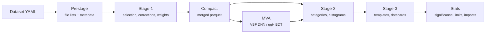

# Copperhead V2

A columnar, coffea-based analysis framework for the CMS Run-3 **H→µµ** search. It turns NanoAOD into
skimmed parquet ntuples, trains the category discriminants (VBF DNN, ggH BDT), builds histograms and
templates, and produces Combine datacards and statistical results.

## Pipeline at a glance



Every stage is driven by `run_analysis_pipeline.sh -m <mode>` (or the Snakemake DAG in `workflow/`); the
VBF statistics chain runs through `run_stats_pipeline_VBF.sh` in the `combine` pixi environment.

## Where to go

<div class="grid cards" markdown>

-   :material-rocket-launch:{ .lg .middle } **Getting started**

    ---

    Clone, enter a pixi environment, start a Dask client, and run prestage + stage-1.

    [:octicons-arrow-right-24: Introduction and setup](Introduction.md)

-   :material-sitemap:{ .lg .middle } **Run the full workflow**

    ---

    Chain stage-1 → compact → stage-2/3 → plots with Snakemake, and inspect its state.

    [:octicons-arrow-right-24: Workflow management](workflow_management.md)

-   :material-filter-cog:{ .lg .middle } **Selection and samples**

    ---

    Run-3 object/event selection, corrections and samples per era, and the 2024–26 MC split.

    [:octicons-arrow-right-24: Run-3 selection](Run3_selection_and_samples.md)

-   :material-tune-variant:{ .lg .middle } **Corrections**

    ---

    Z-pT reweighting, event-by-event mass-resolution calibration, HEM veto.

    [:octicons-arrow-right-24: Z-pT reweighting](ZpT_reweight.md)

-   :material-brain:{ .lg .middle } **Analysis channels**

    ---

    VBF DNN training and the ggH BDT category boundaries, validation and datacards.

    [:octicons-arrow-right-24: VBF DNN](DNN_VBF.md) ·
    [ggH](ggH_steps_after_stage1_v2.md)

-   :material-chart-bell-curve:{ .lg .middle } **Statistics**

    ---

    VBF card/workspace building, significance, expected limits and impacts with Combine.

    [:octicons-arrow-right-24: VBF stats pipeline](Statistics.md)

-   :material-chart-histogram:{ .lg .middle } **Yields and plots**

    ---

    Event yields per category and control/validation plotting.

    [:octicons-arrow-right-24: Get yields](GetYields.md) ·
    [Plotting](PlottingCodes.md)

-   :material-lifebuoy:{ .lg .middle } **Troubleshooting**

    ---

    Known issues with fixes, failed-job checks, and the pre-PR cut-flow cross-check.

    [:octicons-arrow-right-24: Known issues](known_issues.md)

</div>

## Quick start

```bash
git clone --recurse-submodules https://github.com/green-cabbage/copperheadV2.git
cd copperheadV2
./enter_pixi.sh default      # or: ./enter_pixi.sh combine   (statistics)

# prestage, then stage-1, for one year
bash run_analysis_pipeline.sh -m 0 -y 2022preEE -v 12 -c configs/datasets/dataset_nanoAODv12_run3.yaml -l my_label
bash run_analysis_pipeline.sh -m 1 -y 2022preEE -v 12 -c configs/datasets/dataset_nanoAODv12_run3.yaml -l my_label
```

!!! tip "Non-interactive shells"
    `enter_pixi.sh` ends with `exec bash` and hangs in background jobs. Use
    `./run_in_pixi.sh <env> <command> [args...]` there instead.
