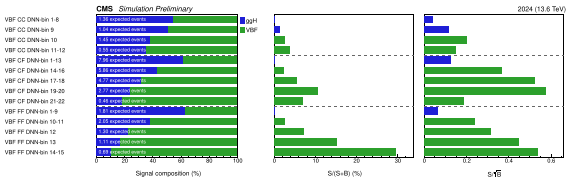
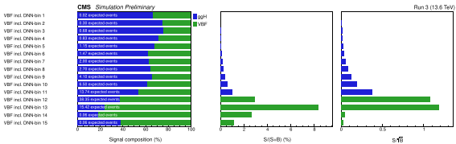

# Signal Composition per Category

`scripts/plot_signal_composition.py` makes a summary plot in the style of the CMS H→µµ paper
(HIG-19-006, signal-composition figure). Each VBF-DNN category gets one row with three panels:

1. **Signal composition (%)**: the share of each Higgs production mode in the category's
   expected signal, with the total expected signal yield written on the bar.
2. **S/(S+B) (%)**: signal over signal plus background.
3. **S/√B**: a rough per-category figure of merit.

In the S/(S+B) and S/√B panels, each bar takes the colour of the category's largest signal
process.

## Inputs

The script reads the **nominal stage-3 templates** written by `run_stage3_vbf.py`:

```
<base-dir>/stage3_datacards_<postfix>[_jj_<region>]/stage3_templates_*/score_*/vbf_h-peak_<year>.root
```

- Histograms whose names end in `_hmm` (`ggH_hmm`, `qqH_hmm`, ...) are **signal**. Every other
  nominal histogram except `data_obs` is **background**. Systematic variations (`*Up`/`*Down`)
  are skipped, so the script works on both nominal-only (`NoSyst`) and full-systematics runs.
- **Rows:** one per DNN-score bin, or per group of bins (`--bin-groups`), for each jj-η region.
- **Years:** yields are summed over `--years`.
- **Signal processes:** Run 3 currently has only ggH and VBF. If WH/ZH/ttH samples are added
  under `*_hmm` names, they appear automatically, using the HIG-19-006 colours.

| `--regions` value | stage-3 directory | row label |
|---|---|---|
| `both_central` | `stage3_datacards_<postfix>_jj_both_central` | `VBF CC` |
| `one_fwd25_one_central` | `stage3_datacards_<postfix>_jj_one_fwd25_one_central` | `VBF CF` |
| `both_fwd25` | `stage3_datacards_<postfix>_jj_both_fwd25` | `VBF FF` |
| `all` (inclusive, stage-3 run with `-r all`) | `stage3_datacards_<postfix>` | `VBF incl.` |

!!! warning "Differences from the paper plot"
    - **B is the full h-peak-window yield** of the template, not the yield in a narrow window
      around the peak as in HIG-19-006. S/(S+B) is therefore lower than in the paper.
    - **S/√B is not the Combine significance.** It ignores systematics and the fit; the
      quadrature sum printed at the end is only a rough cross-check.
    - **Do not pass the merged year `2025_2026` together with `2025` and `2026`.** It is their
      sum, so they would be counted twice.

## How to run

Run from the repo root, in the `default` pixi env:

```bash
./run_in_pixi.sh default python scripts/plot_signal_composition.py \
    --base-dir <ntuple label dir> --postfix <stage-3 postfix> --years <year[,year...]> [options]
```

| Option | Default | Meaning |
|---|---|---|
| `--base-dir` | required | ntuple label directory that holds the `stage3_datacards_*` dirs |
| `--postfix` | required | stage-3 postfix (the `-o` of the run), without `_jj_<region>` |
| `--years` | `2024` | comma list; yields are summed |
| `--regions` | `both_central,one_fwd25_one_central,both_fwd25` | comma list of jj regions, or `all` |
| `--bin-groups` | one row per bin | `"1-6,7-8,9"` for every region, or per region: `"both_central:1-8,9;both_fwd25:1-9,10"` (regions not listed keep one row per bin). Bins are 1-based. |
| `--lumi-text` | `(13.6 TeV)` | top-right label |
| `--cms-text` | `#it{Simulation Preliminary}` | text after "CMS" |
| `--formats` | `pdf,png` | image formats, e.g. `pdf,png,svg` |
| `--tag` | from `--bin-groups` | output file tag |
| `--outdir` | `validation/signal_composition/<label>/<postfix>_<years>/` | output directory |

**Outputs:**

- `signal_composition_<tag>.{pdf,png}`: the plot.
- `signal_composition_<tag>.csv`: per category, S, B, the yield of each signal process,
  S/(S+B) and S/√B.
- The same table, plus the quadrature sum of S/√B, is printed to the terminal.

## Examples

### Three jj regions with merged bins (2024)

```bash
./run_in_pixi.sh default python scripts/plot_signal_composition.py \
    --base-dir /work/projects/hmm/shar1172/hmm_ntuples/copperheadV1clean/Run3_nanoAODv15_FilterEvents_Oct29_tightPassLepVeto_PUDNNTrain1Oct29_JERStrat4_JetIDVars_LumiSplit_HPO200 \
    --postfix Nov01_2026_Syst_DNN2024Ray200_DY105 --years 2024 --lumi-text "2024 (13.6 TeV)" \
    --bin-groups "both_central:1-8,9,10,11-12;one_fwd25_one_central:1-13,14-16,17-18,19-20,21-22;both_fwd25:1-9,10-11,12,13,14-15" \
    --tag CC_CF_FF_grouped
```



The bin groups in this example are a hand-made choice: low-score bins merged, highest-S/B bins
kept separate. Leave out `--bin-groups` to get one row per DNN bin (49 rows for this model).

### Inclusive jj region, all Run-3 years

Stage-3 for this example was run with `-r all`, nominal only, using the Oct23 inclusive DNN
model on the Oct26 ntuples.

```bash
./run_in_pixi.sh default python scripts/plot_signal_composition.py \
    --base-dir /work/projects/hmm/shar1172/hmm_ntuples/copperheadV1clean/Run3_nanoAODv15_FilterEvents_Oct26_tightPassLepVeto_OfficialRecomendation_Systematics_LumiSplit \
    --postfix Nov10_2026_NoSyst_DNNOct23Ray050_DY105 --regions all \
    --years 2022preEE,2022postEE,2023,2023BPix,2024,2025,2026 --lumi-text "Run 3 (13.6 TeV)"
```



The top two bins in this plot hold almost no signal. The binning comes from the Oct23 model's
score dump, not from these ntuples, so it does not match their score distribution. A score dump
and bin scan on the plotted ntuples (see [Statistics Pipeline](Statistics.md)) gives a better
binning.

## Regenerating the doc images

`*.png` is gitignored, so the doc images are SVG files in `docs/images/signal_composition/`.
To regenerate them, rerun the two example commands with:

```
--formats svg --outdir docs/images/signal_composition --tag example_split_regions_2024
```

for the first example, and `--tag example_inclusive_run3` (same `--formats` and `--outdir`)
for the second.
